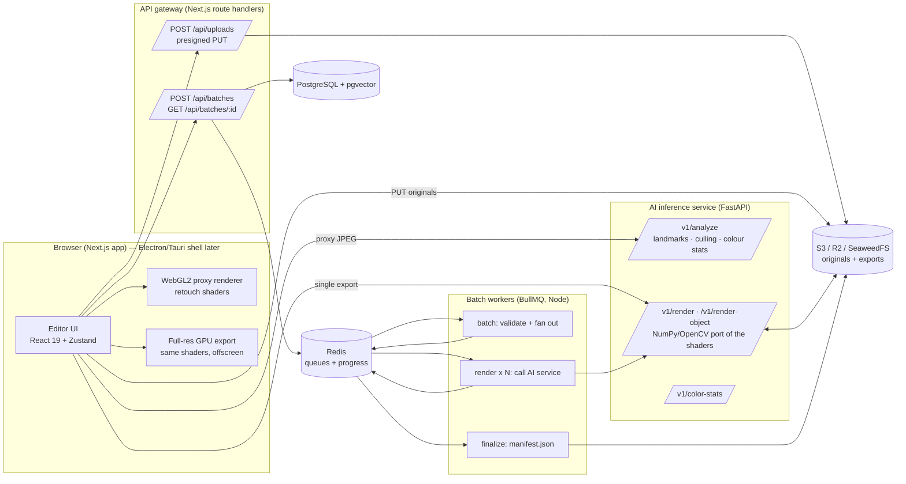

# FineRetouch architecture

FineRetouch is an AI-assisted retouching platform for photographers who deliver hundreds or thousands of portraits per shoot: wedding, event, school, studio and e-commerce work. The workflow it optimises is **edit one, sync to all, export everything**, with AI handling the repetitive parts (skin, eyes, teeth, colour consistency, culling).

This document covers the system design, the AI model map (what runs today and what is planned), the data flow of a photo, and how to run the stack.

---

## 1. System overview



| Component | Path | Tech | Responsibility |
| :--- | :--- | :--- | :--- |
| Web editor + API gateway | `apps/web` | Next.js 16 (App Router), React 19, TypeScript, Tailwind CSS 4, Radix UI, Zustand, WebGL2 | Import, live preview, sliders, presets, sync, culling UI, export; thin API for uploads and batch jobs |
| Shared model | `packages/shared` | TypeScript | `Adjustments` schema, slider ranges, presets, sanitisation, job/analysis contracts used by every service |
| AI service | `services/ai` | Python 3.12, FastAPI, MediaPipe Face Landmarker, OpenCV, NumPy, Pillow | Face landmarks and regions, culling signals, colour statistics, full-resolution rendering |
| Batch worker | `services/worker` | Node 22, BullMQ, ioredis, AWS SDK v3 | Fan a batch out to per-image render jobs with retries; track progress; write manifests |
| Database | `db/init.sql` | PostgreSQL 17 + pgvector | Users, projects, images, edit history, presets, batches, image embeddings |
| Queue / cache | — | Redis 7 | BullMQ queues, batch progress hashes, pub/sub progress events |
| Object storage | — | S3, Cloudflare R2, or SeaweedFS locally | Originals (`uploads/{user}/…`) and exports (`exports/{user}/{batch}/…`) |

### Why this split

- **The preview never waits for the network.** Retouching is expressed as a small set of numbers (`Adjustments`). The browser renders them on the GPU from a proxy; the server and workers render the same numbers at full resolution. Moving a slider costs one fragment-shader pass.
- **The AI service only does what needs a model.** Landmark detection runs once per photo (on a 1280 px JPEG, not the original), and its output is a handful of polygons. Every slider afterwards is pure image processing.
- **Batch is a queue, not a request.** A 1,000-image export is one `batch` job that fans out into 1,000 idempotent `render` jobs (`jobId = batchId-imageId`) with exponential-backoff retries. Throughput scales by adding worker replicas and AI service replicas independently.
- **One source of truth for edit semantics.** `packages/shared` defines ranges and sanitisation; `services/ai/app/schemas.py` mirrors it with Pydantic, and the GLSL in `apps/web/src/engine/shaders.ts` mirrors `services/ai/app/pipeline.py` stage for stage. A browser export and a server export of the same photo differ by under 1/255 on average (measured: mean absolute difference 0.79, 99th percentile 4).

---

## 2. Life of a photo

**1. Import (browser).** Files are decoded with `createImageBitmap` (EXIF orientation applied), producing a ≤2560 px proxy bitmap, a 320 px thumbnail and client-side L\*a\*b\* statistics. Originals stay as `File` objects in memory; nothing is uploaded for local editing.

**2. AI analysis.** A 1280 px JPEG of the proxy is posted to `POST /v1/analyze`. The service returns, per face, normalised polygons (face oval, eyes, under-eye crescents, lips, inner mouth, brows), an eye-openness score from the eye aspect ratio, plus image sharpness (variance of the Laplacian) and L\*a\*b\* statistics. Culling flags (`blurry`, `eyesClosed`, `noFace`) are derived from those. If the service is down the editor keeps working with colour-based skin detection, and retries analysis when the health check recovers.

**3. Proxy mask rendering.** The polygons are rasterised on the CPU into one feathered RGBA mask at ≤1536 px (`r` skin, `g` eyes, `b` under-eye, `a` mouth), using the same relative feather radii as the server. The mask is sampled by UV, so it does not need to match the proxy size.

**4. Slider adjustment.** On photo load the renderer computes three Gaussian bands of the proxy (σ = 0.12 %, 0.4 % and 1.2 % of the long edge) once. Each slider change only re-runs the retouch pass and the display pass:

| Stage | What it does |
| :--- | :--- |
| Skin probability | YCbCr chroma box, gated by the face-oval mask when a face exists |
| Frequency separation | Tone layer = s1 band, detail layer = source − s1. The blotch band (s1 − s2) is removed from the tone layer and the detail layer is re-injected by *Texture retention* (100 % keeps every pore), skipping strong edges. Export adds an adaptive median on the tone layer (§2b) |
| Spot healing | Spots darker or redder than their surroundings at the fine/coarse scale get the coarse band plus their own texture (face mask only, so red pimples are not skipped); 2x/3x widen detection; very dark neutral spots are kept as beauty marks. Export runs the full local healer (§2b) |
| Even skin tone | Pulls skin chroma toward the local average |
| Skin-tone guard | CIELAB chroma floor and hue lock on retouched skin (*Protect skin tone*, §2b); same maths in the shader and `skin_tone_guard` |
| Eyes / dark circles / teeth | Region-masked exposure + local contrast; under-eye luminance lift and chroma neutralisation; yellow removal and lift on bright mouth pixels |
| Skin boost 2x/3x | Extra pass for stubborn spots, pigment and redness (see §2a); approximated live, full algorithm on server export |
| Stray hair cleanup | Thin-strand removal inside a band around the face outline and forehead (see §2a); approximated live |
| Colour match | Covariance-aligning (Monge-Kantorovich) transfer in CIE L\*a\*b\* plus a histogram-matched L\* tone curve; Reinhard per-channel fallback for old presets |
| Global tone | Exposure and white balance in linear light; highlights, shadows, contrast, saturation, vibrance |
| Colour mixer and grading | 8-channel HSL mixer, then shadows / midtones / highlights wheels (§2b); identical maths in the shader, `engine/colorMixer.ts` and `color_engine.py` |
| Detail | Sharpening (reduced on smoothed skin); vignette |

After the retouch pass, an optional **depth-of-field chain** runs: downsample → two gather-bokeh passes (full radius, then 45 %: the "double blur") → composite by circle of confusion.

The display pass handles zoom up to 800 % (nearest-neighbour above 2×), pan, before/after split, side-by-side, a **difference heat map** (where and how strongly the edit changed the photo, for catching over-retouching) and an AI-mask overlay.

### 2a. Boosted retouch, stray hair, depth bokeh and style sync (v0.2)

These live in `services/ai/app/retouch_engine.py` (full quality, used by server and batch exports) with real-time approximations in `apps/web/src/engine/shaders.ts`. With all of them off, the browser and server renderers still agree to within 1/255 on average; with them on, the preview is a faithful approximation and the export runs the full algorithm.

| Feature | Settings (`Adjustments`) | Server algorithm | Live preview |
| :--- | :--- | :--- | :--- |
| Skin & blemish boost | `skinMultiplier: 1 \| 2 \| 3` | Gaussian split → recursive guided filtering (1 + ⌈m−1⌉ passes, guide = original luma) of the colour layer; dark-spot / redness z-scores against a skin-only base, kept only for compact blobs so contouring survives; detail-layer blemishes (adaptive threshold vs local texture energy, morphological opening to skip pores) are Telea-inpainted and re-grained from nearby skin. All radii scale with face size. | Extra detail-spot patching from the s1 band plus pigment/redness evening against a fourth band (s3 = 3 % of the long edge) |
| Stray hair cleanup | `strayHairRemoval: {enabled, strength}` | ROI band around the landmark face oval (forehead weighted; eyes, brows, lips and everything below the mouth excluded) → black-hat/top-hat thin-structure response → 8-orientation Gabor line-ness → adaptive threshold → elongated components only → Telea inpainting. The selfie segmenter's hair class protects the hairstyle itself. | Thin-strand detector (fine vs s1 band) inside the same ROI, filled from the s1 band |
| Depth bokeh | `depthBokeh: {enabled, blurRadius 0–100, bokehMultiplier 100–300 %, apertureShape circle \| hex, highlightBoost}` | Depth (0 = subject, 1 = far) from MiDaS v2.1 small via OpenCV DNN, normalised to the faces, with the person mask pinned to the focal plane and edges refined by a guided filter. Layered disk/hex convolution in linear light (8 CoC layers, normalised so the subject never halos), highlight gain before blurring, large radii run downscaled. | Same depth map (`POST /v1/depth`) or a face-box portrait prior offline; gather bokeh with a 48-tap Vogel-spiral kernel (hexagon-stretched for `hex`), sample CoC test to stop subject bleed, two passes |
| Style sync | `colorMatch` (palette mode) or ordinary sliders | `style_profile` (L\*a\*b\* mean/covariance/quantiles, contrast, warmth, chroma, Laplacian sharpness, skin texture energy) → `map_style_to_adjustments` | Same profile computed in the browser; `mapStyleToAdjustments` in `packages/shared/src/style.ts` |

### 2b. Natural retouch, spot healing, colour mixer and grading, exports and watermarks (v0.5)

**Natural frequency-separation retouch** (`natural_skin_retouch` in `retouch_engine.py`; the *Smoothing*, *Texture retention* and *Spot healing* sliders). Replaces flat blurring with work on two layers:

1. Spots are healed first (below): their tone is inpainted and their outline, which is detail-scale, is replaced by healthy pores cloned from nearby skin. Nothing else is touched.
2. The image is split into a **tone layer** (Gaussian, σ = 0.4 % of the long edge, the renderer's s1) and a **detail layer** (the remainder: pores, peach fuzz, fine lines); tone + detail reproduces the image exactly.
3. Only the tone layer is smoothed: the blotch band between s1 and s2 is suppressed (× 0.85 × Smoothing × skin, skipping strong edges), then an **adaptive median** evens what is left. The median runs on a copy shrunk to ~0.6 σ per pixel and its change fades out where it would exceed 0.025–0.06 luma anywhere nearby, so moles, brows and contours stay.
4. The detail layer goes back on top: `detail × (1 − k × (1 − retention))`, where k is the local smoothing weight. At 100 % *Texture retention* every pore returns unchanged; at 0 % Smoothing also flattens texture (the "plastic" look, there if someone wants it).

**Skin-tone guard** (`skin_tone_guard`, *Protect skin tone*, on by default). Runs after smoothing, spot healing, even skin tone and the 2x/3x boost. In CIELAB, a retouched skin pixel's chroma may not fall below 90 % of the lower of its original chroma and its surroundings' chroma (the s2 band of the original), and its hue may leave the arc between those two hues by at most 6°. L\* is never changed, and pixels the retouch did not desaturate or turn keep their exact values, so freckles and natural variation in melanin are untouched; only ashen or off-hue results are pulled back. Constants live in `SKIN_TONE_GUARD` (shared) and `TONE_GUARD_*` (Python), and a test keeps them equal.

**Spot healing** (`heal_spots` in `retouch_engine.py`, the *Spot healing* slider plus the 1x/2x/3x multiplier). Replaces the old global low-band blend on export with local repairs:

1. *Signal*: darkness + 1.5 × redness relative to a skin-only local base (normalised blur), so red pimples and brown spots both read as bright blobs. The colour-based skin mask is morphologically closed first, because a red pimple fails the skin-tone test.
2. *Detection*: a pore-wide median filter removes pores and pore clusters, then a scale-normalised Laplacian of Gaussian at four scales (0.65–2.2 % of face width) finds blobs. The threshold is `median + k × MAD` of the response on this photo's skin (k = 3.0 / 2.4 / 1.9 for 1x / 2x / 3x), with an absolute floor, so grainy and clean photos get the same false-positive rate.
3. *Filtering*: compact, round components only (wrinkles and lash lines are long); size limits grow with the multiplier (5 / 7 / 9 % of face width). Eyes (wide horizontally, to cover crow's feet), brows, lips and the lower nose (`FaceRegions.nose`, a hull of mesh points 2, 19, 97, 98, 64, 48 and their mirrors) are excluded.
4. *Beauty marks*: a spot at least 0.2 luma darker than the skin, not red and at least 1.2 % of face width is a mole and is kept (unless *Keep beauty marks* is off).
5. *Repair*, per spot: the tone layer (Gaussian at ~0.8 % of face width) is Telea-inpainted from the healthy rim; the texture layer is cloned from the best-matching healthy patch nearby (12 directions × 2 distances, chosen by tone match), so healed skin keeps pores. Everything outside the spots is bit-identical.

**Colour mixer and grading** (`color_engine.py`, `ColorMixerPanel.tsx`). Eight channels centred at 0/30/60/120/180/240/270/300°; each pixel's HSV hue is split between its two neighbouring channels with a smoothstep, so weights sum to 1. Hue ±100 = ±30°, saturation ×0–×2, luminance ±60 %, all faded out below saturation 0.2 so greys never pick up a cast; hue and saturation moves keep the pixel's luma. Grading splits luma into shadows (< 25 %), midtones and highlights (> 75 %) with smoothstep crossovers (*Blending* sets their width 0.05–0.45, *Balance* shifts both pivots ±0.2); each wheel adds a zero-luma chroma offset of its hue (× saturation) plus an optional luminance offset. The export path uses OpenCV HSV and 0.1° lookup tables (about 3.5 s for a 21 MP frame on a CI-class CPU), the GPU does it per pixel in the retouch pass.

**Exports and watermarks** (`lib/exportManager.ts`, `lib/watermark.ts`, `ExportModal.tsx`). See DESKTOP.md for destinations and permissions. The watermark (text and/or PNG logo, font, weight, colour, opacity, 9-point anchor, margin, soft shadow) is drawn onto the full-resolution pixels right before encoding. Sizes are percentages of the short edge, so a 1080 px proof and a 45 MP print carry the same-looking mark; the modal's preview runs the same drawing code. AI-engine renders are requested as PNG when a watermark is on, so the file is encoded once more, not twice lossy. Cloud batch exports are not watermarked.

Max blur radius is `blurRadius/100 × 2 % of the long edge × bokehMultiplier/100`, so 300 % on a 6000 px export is a 360 px circle of confusion.

**Style sync.** A reference photo is measured once (`StyleProfile`). *Exact palette* stores the reference statistics in `colorMatch`; the renderer derives the 3×3 transfer from each photo's own statistics at render time, so one patch works for a whole shoot (and for batch jobs). Clipped pixels (blown studio white, crushed black) are left out of the statistics and each tone-curve knot moves at most 25 L\*, so a white-backdrop reference re-grades instead of blowing out the photo. *Editable sliders* expresses the same intent through exposure, contrast, temperature, tint and saturation. Both modes also map retouch intensity: smoother reference skin raises smoothing/blemish removal (and switches to 2x when much smoother); a crisper reference raises sharpening. *Sync style to all* applies it to every photo in the shoot.

### 2b. Camera RAW (v0.3)

RAW support is split by cost. Demosaicing a 24-100 MP Bayer mosaic is seconds of work per file, too slow for importing a card into the filmstrip, so the browser never demosaics.

- **Browser** (`apps/web/src/lib/rawParser.ts`): magic-byte detection, then a structural walk that reads only headers through `Blob.slice` — TIFF IFD chains and SubIFDs for CR2/NEF/ARW/DNG/ORF/RW2/PEF (`JPEGInterchangeFormat`, JPEG strips, RW2 `JpgFromRaw`), the ISOBMFF track-1 sample and `PRVW` box for CR3, the header pointer for RAF. Every candidate's JPEG frame header is probed and lossless JPEG (CR2/DNG sensor data, which browsers cannot decode) is rejected; the largest baseline/progressive frame wins, with a whole-file scan as the fallback for damaged or maker-note-only files. The preview is returned as a slice of the original `File` (no copy), so importing hundreds of RAWs costs a few ms of parsing each plus the JPEG decode. EXIF (camera, lens, ISO, shutter, aperture, focal length, colour space, orientation) comes from IFD0 + Exif IFD, Canon's `CMT1`/`CMT2` boxes, or the preview's own APP1. The RAW's orientation is applied with a canvas transform unless the preview carries its own. The viewport, analysis, depth and style sync all work on that preview, and the GPU export uses it too (8-bit, camera rendering; the export dialog says so).
- **AI service** (`services/ai/app/raw_engine.py`): `decode_camera_raw` runs LibRaw through `rawpy` and returns an oriented HxWx3 `uint16` array. White balance is applied to linear sensor values: as-shot camera multipliers, daylight, or a Kelvin/tint target turned into multipliers through the camera's XYZ→camera matrix (Planckian xy from Kim et al.; for DNG the inverse of LibRaw's camera→sRGB matrix stacked on the daylight multipliers). Options: demosaic (AHD default, DHT, PPG, VNG, DCB, AAHD, linear), highlight mode (clip, ignore, blend, reconstruct), output space (sRGB, Adobe RGB, ProPhoto with their transfer curves), half-size decoding when the requested size is at most half the sensor. `imageio.decode_hq` feeds the 16-bit array straight into `pipeline.render` (which accepts `uint16`), while detectors get an 8-bit copy. A damaged file falls back to the embedded preview (`source="embedded_preview"`, with a warning), and an unreadable one to a structured grey placeholder (`ok=False`); HTTP endpoints turn the latter into 415 instead of rendering grey.
- **Upload path:** RAW originals upload with a stable `image/x-…` content type (browsers usually report an empty type) and up to 400 MB; the worker is format agnostic because the AI service detects the container from the bytes.
- **CR4:** Canon has not published a CR4 format. The extension is accepted so nothing on a card is rejected by name, but such a file is opened only if its bytes are one of the supported containers; otherwise the import reports it as unreadable.

**AI assist.**
- *Auto Retouch* measures the photo (same profile) and sets damped corrections toward a well-exposed portrait target plus skin work scaled to the measured skin texture and eye/teeth work when a face exists.
- *Smart Sync* copies the active photo's edits to the selection (or all) but compensates exposure, temperature and tint for the difference between each original and the hero original, so a shoot in changing light lands on one look instead of copying the same numbers.

**5. Sync and presets.** Edits are per photo with an undo/redo stack (100 steps; one step per slider drag). *Copy / Paste*, *Sync to all / selected* and presets write the same `Adjustments` to many photos, each as its own undo step.

**6. Export.** Three engines, chosen per export:
- **This device (GPU):** the same shader chain at full resolution in an offscreen WebGL2 context (up to the GPU's max texture size), then JPEG/PNG/WebP encoding and a ZIP for multiple files.
- **AI service:** `POST /v1/render` with the original and the `Adjustments`; landmarks are re-detected on the full image.
- **Cloud batch:** originals go straight to object storage through presigned URLs; `POST /api/batches` queues one job; workers call `POST /v1/render-object` for each image; `GET /api/batches/:id` reports progress and returns signed download links from the manifest.

---

## 3. AI pipeline and model map

**Status key:** ✅ implemented in this repo · 🧪 heuristic version implemented, model upgrade planned · 🗺️ planned.

| Feature | Model / technique | Input → output | Target latency | Status |
| :--- | :--- | :--- | :--- | :--- |
| Face detection and mesh | MediaPipe Face Landmarker (478 points incl. iris), OpenCV Haar fallback | RGB ≤1280 px → 478 normalised 3D landmarks → region polygons | < 30 ms CPU per image | ✅ |
| Eyes-closed culling | Eye aspect ratio from landmarks (blendshapes `eyeBlink*` as upgrade) | landmarks → openness 0–1 | < 1 ms | ✅ |
| Blur culling | Variance of the Laplacian on a 1024 px grey proxy | grey → scalar | < 5 ms | ✅ |
| Skin mask | Face-oval polygon × YCbCr skin probability | RGB + polygons → soft mask | < 2 ms GPU | 🧪 → BiSeNet face parsing (19 classes) |
| Frequency separation | Three-band Gaussian pyramid, edge-aware band suppression | RGBA → low/mid/fine bands → retouched RGB | < 5 ms GPU on a 2560 px proxy | ✅ |
| Spot healing | Multi-scale LoG spot detector + Telea tone inpainting + healthy-patch texture cloning (export); band replacement (preview) | skin mask + landmarks → per-spot repairs | < 5 ms GPU preview; ~0.5 s per 1 MP face on CPU | ✅ (LaMa could replace Telea for very large spots) |
| Skin tone unification | Local chroma averaging | RGB → RGB | < 2 ms GPU | ✅ (neck/hand matching to face 🗺️) |
| Eye brighten, dark circles, teeth whitening | Landmark region masks + tone operators | RGB + masks → RGB | < 2 ms GPU | ✅ |
| Colour match / style sync | Monge-Kantorovich covariance transfer + 17-knot L\* histogram matching; style profile → slider mapping | source + reference stats → RGB | < 2 ms GPU, < 60 ms CPU | ✅ (sliced optimal transport / neural transfer 🗺️) |
| Skin boost 2x/3x | Recursive guided filter + adaptive spot detection + Telea inpainting with re-grain | RGB + skin mask → RGB | ~1.3 s CPU at 1 MP face crop (3x) | ✅ (LaMa for large patches 🗺️) |
| Stray hair cleanup | Morphological thin-structure + Gabor line detector in a landmark ROI, Telea inpainting | RGB + landmarks (+ hair mask) → RGB | ~0.3 s CPU | ✅ (SAM 2 strand masks + LaMa 🗺️) |
| Depth estimation | MiDaS v2.1 small (ONNX, OpenCV DNN) + MediaPipe selfie multiclass segmenter, guided-filter refinement; portrait prior fallback | RGB ≤512 px → relative depth | ~0.35 s CPU | ✅ (Depth Anything v2 🗺️) |
| Depth bokeh | Layered aperture convolution (server), double gather pass (GPU) | RGB + depth → RGB | < 10 ms GPU proxy, ~1 s CPU at 1 MP | ✅ |
| Face restoration | CodeFormer / GFPGAN (ONNX, TensorRT) | face crop 512² → restored crop | < 80 ms GPU | 🗺️ |
| Background matting / replacement | MODNet or ViTMatte | RGB → alpha | < 80 ms GPU | 🗺️ |
| Wires, backdrop seams, large stray-hair clumps | SAM 2 prompts + LaMa / SD inpainting | RGB + prompts → mask → inpainted RGB | < 150 ms GPU | 🗺️ |
| Clothes de-wrinkling | ControlNet-tile + inpainting on garment mask | RGB + mask → RGB | < 300 ms GPU | 🗺️ |
| Face/body shaping | Landmark-driven mesh warp with background protection mask | RGB + landmarks → warped RGB | < 20 ms GPU | 🗺️ |
| Relighting | Monocular depth (Depth Anything v2) + normal-based light shader | RGB → depth → relit RGB | < 60 ms GPU | 🗺️ |
| Near-duplicate grouping | CLIP/SigLIP image embeddings in pgvector (column and HNSW index exist) | RGB → 512-d vector | < 20 ms GPU | 🗺️ |

Planned GPU models should run behind the same FastAPI contract, exported to ONNX and served with ONNX Runtime (CUDA/TensorRT execution providers) or Triton, so the web app and worker do not change when a heuristic is upgraded to a model.

---

## 4. Frontend structure and state

```
apps/web/src
├── app
│   ├── layout.tsx, globals.css        Theme tokens (Tailwind 4 @theme), component classes
│   ├── page.tsx                       Redirects to /editor
│   ├── editor/page.tsx
│   └── api/                           Gateway: health, uploads (presign), batches (+ [id])
├── components
│   ├── Editor.tsx                     Shell, import pipeline, AI health, keyboard shortcuts
│   ├── PhotoEditorViewport.tsx        WebGL2 canvas, zoom/pan, split drag
│   ├── AdjustmentPanel.tsx            Radix sliders grouped by Skin / Face / Light / Color / Detail
│   ├── RetouchControlPanel.tsx        AI pro tools: auto retouch, smart sync, 1x/2x/3x boost, stray hair, bokeh, style sync
│   ├── PresetPanel.tsx                Copy/paste/sync, built-in and saved presets
│   ├── Filmstrip.tsx                  Thumbnails, multi-select, culling badges and filters
│   └── ExportDialog.tsx               GPU / AI service / cloud batch export
├── engine
│   ├── shaders.ts                     GLSL: blur, retouch, display (mirrors services/ai/app/pipeline.py)
│   ├── renderer.ts                    WebGL2 pipeline (cached bands, retouch pass, display pass, readback)
│   ├── masks.ts                       Landmark polygons → feathered RGBA mask, stray-hair ROI, depth prior
│   ├── color.ts                       sRGB → L*a*b*, statistics, Monge-Kantorovich matrix, tone-curve knots, palette
│   └── style.ts                       Style profile of an image (port of retouch_engine.style_profile)
└── lib
    ├── store.ts                       Zustand editor store (photos, history, selection, view, presets)
    ├── images.ts                      Off-store pixel cache: originals, proxies, masks, hair ROIs, depth maps
    ├── depth.ts                       Depth fetch (AI service) with portrait-prior fallback; hair ROI cache
    ├── ai.ts, cloud.ts, export.ts     Service clients and export paths
    └── server/                        Server-only: Redis/BullMQ, S3 presigning, Postgres, session id
```

The Zustand store (`lib/store.ts`) holds only serialisable state: per-photo `Adjustments`, undo/redo stacks, AI analysis, cull flags, the selection, the view (compare mode, split, zoom, pan, mask overlay), the settings clipboard and custom presets. Pixel data (bitmaps, masks) lives in `lib/images.ts` keyed by photo id so React re-renders stay cheap.

The store also holds `styleSync` (`referenceImageId`, `matchedPalette`, `mode`, `amount`, `syncTargetBatch`) and, per photo, a `profile` (style metrics of the original) and `depthState`. The v0.2 settings (`skinMultiplier`, `strayHairRemoval`, `depthBokeh`) are part of each photo's `Adjustments`, so undo, copy/paste, presets, sync and batch jobs carry them automatically.

Keyboard: `Ctrl/Cmd+Z` undo, `Ctrl/Cmd+Shift+Z` redo, `Ctrl/Cmd+Shift+C/V` copy/paste settings, `Ctrl/Cmd+A` select all, `←/→` navigate, `\` before/after, `Y` split, `D` difference heat map, `M` mask overlay, `X` reject, `0` fit, `1` 100 %, `+/-` zoom.

---

## 5. AI service API

| Method | Path | Body | Returns |
| :--- | :--- | :--- | :--- |
| GET | `/health` | — | `{status, faceBackend, depthBackend}` |
| POST | `/v1/analyze` | multipart `file` | `ImageAnalysis` (faces with regions, sharpness, colour stats, cull flags) |
| POST | `/v1/color-stats` | multipart `file` | `ColorStats` (L\*a\*b\* mean/std/covariance, L\* quantiles) |
| POST | `/v1/depth` | multipart `file` | 8-bit PNG depth (0 = subject, 255 = far, ≤512 px); `X-Depth-Backend` header |
| POST | `/v1/style/profile` | multipart `file` | `StyleProfile` |
| POST | `/v1/style/sync` | multipart `reference`, `targets` (repeated, ≤200), `mode` (`palette`/`sliders`), `amount` | `{reference, targets: [{name, profile, adjustments}]}` (patches validate as `Adjustments`) |
| POST | `/v1/render` | multipart `file`, `adjustments` (JSON), `format`, `quality`, `maxLongEdge` | encoded image |
| POST | `/v1/raw/metadata` | multipart `file` (camera RAW) | `{format, make, model, lens, iso, exposure_time, shutter, f_number, focal_length, orientation, width, height, …}` |
| POST | `/v1/raw/preview` | multipart `file`, `maxLongEdge`, `mode` (`embedded`/`demosaic`), `quality` | JPEG; `X-Raw-Source` header |
| POST | `/v1/render-object` | JSON `{sourceKey, outputKey, adjustments, output}` | `{outputKey, bytes, ms, cull}`; reads/writes object storage |

Interactive docs at `http://localhost:8000/docs` when running.

---

## 6. Batch processing

```
POST /api/batches ──► queue "fineretouch-batch" ── job "batch" (jobId = batchId)
                          │  validate (ids, user prefix, ≤ 5000 items), merge preset + per-image overrides
                          ▼
                     FlowProducer: parent "finalize" + N children "render" on "fineretouch-render"
                          │  children: jobId batchId-imageId, 3 attempts, exponential backoff,
                          │  4xx from the AI service = UnrecoverableError (no retry)
                          ▼
                     render worker (concurrency RENDER_CONCURRENCY per replica)
                          │  POST ai:/v1/render-object → S3 exports/{user}/{batch}/{prefix}{imageId}.{ext}
                          │  HINCRBY fineretouch:batch:{id} done|failed, PUBLISH progress
                          ▼
                     finalize (runs once all children finish or fail): manifest.json, state = completed[_with_errors]
```

Throughput is roughly `worker replicas × RENDER_CONCURRENCY`, bounded by AI service capacity (`WEB_CONCURRENCY` processes per replica; NumPy and OpenCV release the GIL, so each process uses several cores). On CPU, a 24 MP image takes about 1.5–3 s; GPU-accelerated rendering in the AI service (CuPy or Torch ports of `pipeline.py`) is the next step for very large batches.

---

## 7. Running it

### Full stack with Docker

```bash
cp .env.example .env          # optional; compose has working defaults
docker compose up --build
# Web http://localhost:3000 · AI docs http://localhost:8000/docs · S3 (SeaweedFS) http://localhost:8333
docker compose up --scale worker=4   # more render throughput
```

### Local development

```bash
# 1. Infrastructure only
docker compose up -d postgres redis s3

# 2. AI service
cd services/ai
python -m venv .venv && . .venv/bin/activate
pip install -r requirements-dev.txt
./scripts/download-model.sh            # Face Landmarker (3.7 MB) + selfie segmenter (16 MB) + MiDaS small (67 MB); SKIP_OPTIONAL_MODELS=1 for faces only
uvicorn app.main:app --reload --port 8000
# Linux needs libegl1 and libgles2 for MediaPipe (apt install libegl1 libgles2)

# 3. Web app and worker (repo root)
npm install
npm run build -w @fineretouch/shared
cp .env.example apps/web/.env.local
npm run dev:web                        # http://localhost:3000
REDIS_URL=redis://localhost:6379 AI_SERVICE_URL=http://localhost:8000 \
  S3_ENDPOINT=http://localhost:8333 S3_ACCESS_KEY=fineretouch S3_SECRET_KEY=fineretouch-dev-secret \
  npm run dev:worker
```

The editor works with only `npm run dev:web`: face-aware tools and server export light up when the AI service is reachable, and cloud batch export appears when Redis and object storage are configured.

### Tests

```bash
npm test                               # shared, web (store, masks, colour) and worker (job planning, retries)
cd services/ai && pytest               # pipeline, colour science, boost/hair/bokeh/depth/style engine and HTTP API
FINERETOUCH_FACE_FIXTURE=/path/to/portrait.jpg pytest   # also checks real landmark detection
```

---

## 8. Security and limits

- Uploads are namespaced by user (`uploads/{userId}/…`); batch requests and the worker both reject source keys outside that prefix or containing `..`. Batch status is only returned to the user who created it.
- Presigned URLs expire after 15 minutes (upload) and 1 hour (download). Uploads are limited to 400 MB and image or camera RAW content types; batches to 5,000 items.
- The AI service validates every adjustment against the shared ranges, caps decoded pixels (`Image.MAX_IMAGE_PIXELS`) and upload size (`MAX_UPLOAD_MB`), and restricts CORS to `CORS_ORIGINS`.
- **Auth:** the gateway currently identifies browsers with an anonymous `httpOnly` cookie (`lib/server/session.ts`). Swap `userId()` for a real provider (Auth.js, Clerk, Supabase Auth) before exposing the cloud endpoints publicly. The AI service should then sit on a private network or require a service token.

---

## 9. Roadmap

1. Persist projects: save images, edits and analysis to Postgres; resume sessions across devices.
2. Desktop shell (Tauri) with a local AI sidecar for offline editing and RAW decoding (LibRaw).
3. GPU models from the table above, starting with face parsing (better skin masks), LaMa blemish inpainting on export, and MODNet background replacement.
4. Tone-curve panel, lens profiles, local adjustment brushes (HSL mixer and colour grading shipped in v0.5).
5. Embedding-based duplicate grouping and best-of-burst picking for culling.
