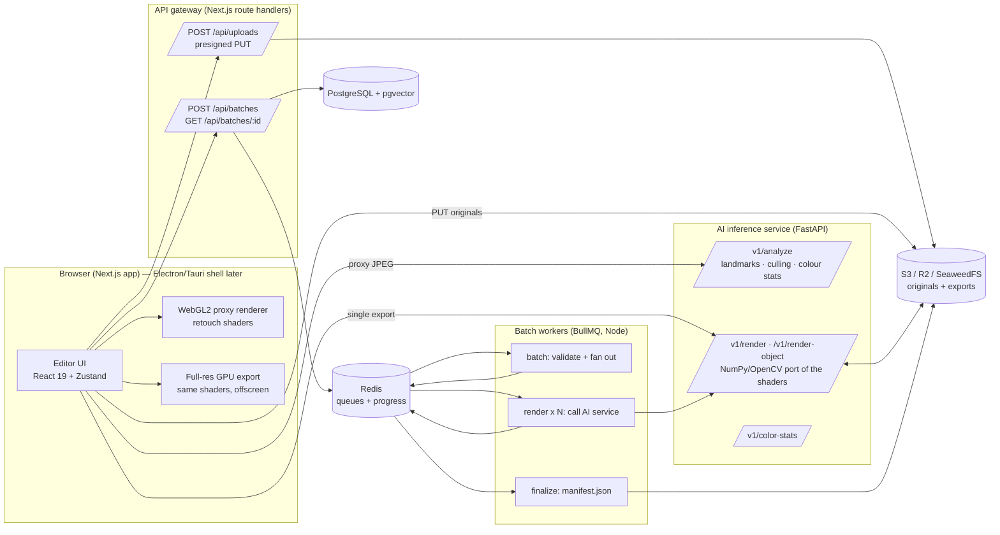

# FineRetouch architecture

FineRetouch is an AI-assisted retouching platform for photographers who deliver hundreds or thousands of portraits per shoot: wedding, event, school, studio and e-commerce work. The workflow it optimises is **edit one, sync to all, export everything**, with AI handling the repetitive parts (skin, eyes, teeth, colour consistency, culling).

This document covers the system design, the AI model map (what runs today and what is planned), the data flow of a photo, and how to run the stack.

---

## 1. System overview



| Component | Path | Tech | Responsibility |
| :--- | :--- | :--- | :--- |
| Web editor + API gateway | `apps/web` | Next.js 16 (App Router), React 19, TypeScript, Tailwind CSS 4, Radix UI, Zustand, WebGL2 | Import, live preview, sliders, presets, sync, culling UI, export; thin API for uploads and batch jobs |
| Shared model | `packages/shared` | TypeScript | `Adjustments` schema, slider ranges, presets, sanitisation, job/analysis contracts used by every service |
| AI service | `services/ai` | Python 3.12, FastAPI, MediaPipe Face Landmarker, OpenCV, NumPy, Pillow | Face landmarks and regions, culling signals, colour statistics, full-resolution rendering |
| Batch worker | `services/worker` | Node 22, BullMQ, ioredis, AWS SDK v3 | Fan a batch out to per-image render jobs with retries; track progress; write manifests |
| Database | `db/init.sql` | PostgreSQL 17 + pgvector | Users, projects, images, edit history, presets, batches, image embeddings |
| Queue / cache | — | Redis 7 | BullMQ queues, batch progress hashes, pub/sub progress events |
| Object storage | — | S3, Cloudflare R2, or SeaweedFS locally | Originals (`uploads/{user}/…`) and exports (`exports/{user}/{batch}/…`) |

### Why this split

- **The preview never waits for the network.** Retouching is expressed as a small set of numbers (`Adjustments`). The browser renders them on the GPU from a proxy; the server and workers render the same numbers at full resolution. Moving a slider costs one fragment-shader pass.
- **The AI service only does what needs a model.** Landmark detection runs once per photo (on a 1280 px JPEG, not the original), and its output is a handful of polygons. Every slider afterwards is pure image processing.
- **Batch is a queue, not a request.** A 1,000-image export is one `batch` job that fans out into 1,000 idempotent `render` jobs (`jobId = batchId-imageId`) with exponential-backoff retries. Throughput scales by adding worker replicas and AI service replicas independently.
- **One source of truth for edit semantics.** `packages/shared` defines ranges and sanitisation; `services/ai/app/schemas.py` mirrors it with Pydantic, and the GLSL in `apps/web/src/engine/shaders.ts` mirrors `services/ai/app/pipeline.py` stage for stage. A browser export and a server export of the same photo differ by under 1/255 on average (measured: mean absolute difference 0.79, 99th percentile 4).

---

## 2. Life of a photo

**1. Import (browser).** Files are decoded with `createImageBitmap` (EXIF orientation applied), producing a ≤2560 px proxy bitmap, a 320 px thumbnail and client-side L\*a\*b\* statistics. Originals stay as `File` objects in memory; nothing is uploaded for local editing.

**2. AI analysis.** A 1280 px JPEG of the proxy is posted to `POST /v1/analyze`. The service returns, per face, normalised polygons (face oval, eyes, under-eye crescents, lips, inner mouth, brows), an eye-openness score from the eye aspect ratio, plus image sharpness (variance of the Laplacian) and L\*a\*b\* statistics. Culling flags (`blurry`, `eyesClosed`, `noFace`) are derived from those. If the service is down the editor keeps working with colour-based skin detection, and retries analysis when the health check recovers.

**3. Proxy mask rendering.** The polygons are rasterised on the CPU into one feathered RGBA mask at ≤1536 px (`r` skin, `g` eyes, `b` under-eye, `a` mouth), using the same relative feather radii as the server. The mask is sampled by UV, so it does not need to match the proxy size.

**4. Slider adjustment.** On photo load the renderer computes three Gaussian bands of the proxy (σ = 0.12 %, 0.4 % and 1.2 % of the long edge) once. Each slider change only re-runs the retouch pass and the display pass:

| Stage | What it does |
| :--- | :--- |
| Skin probability | YCbCr chroma box, gated by the face-oval mask when a face exists |
| Frequency separation | Removes the mid band (blotches) and part of the fine band (pores, scaled by *Keep texture*), skipping strong edges |
| Blemish removal | Spots darker or redder than their surroundings at the fine/coarse scale are replaced with the coarse band plus preserved texture |
| Even skin tone | Pulls skin chroma toward the local average |
| Eyes / dark circles / teeth | Region-masked exposure + local contrast; under-eye luminance lift and chroma neutralisation; yellow removal and lift on bright mouth pixels |
| Colour match | Reinhard statistics transfer in CIE L\*a\*b\* toward a reference image |
| Global tone | Exposure and white balance in linear light; highlights, shadows, contrast, saturation, vibrance; sharpening (reduced on smoothed skin); vignette |

The display pass handles zoom up to 800 % (nearest-neighbour above 2×), pan, before/after split, side-by-side and an AI-mask overlay.

**5. Sync and presets.** Edits are per photo with an undo/redo stack (100 steps; one step per slider drag). *Copy / Paste*, *Sync to all / selected* and presets write the same `Adjustments` to many photos, each as its own undo step.

**6. Export.** Three engines, chosen per export:
- **This device (GPU):** the same shader chain at full resolution in an offscreen WebGL2 context (up to the GPU's max texture size), then JPEG/PNG/WebP encoding and a ZIP for multiple files.
- **AI service:** `POST /v1/render` with the original and the `Adjustments`; landmarks are re-detected on the full image.
- **Cloud batch:** originals go straight to object storage through presigned URLs; `POST /api/batches` queues one job; workers call `POST /v1/render-object` for each image; `GET /api/batches/:id` reports progress and returns signed download links from the manifest.

---

## 3. AI pipeline and model map

**Status key:** ✅ implemented in this repo · 🧪 heuristic version implemented, model upgrade planned · 🗺️ planned.

| Feature | Model / technique | Input → output | Target latency | Status |
| :--- | :--- | :--- | :--- | :--- |
| Face detection and mesh | MediaPipe Face Landmarker (478 points incl. iris), OpenCV Haar fallback | RGB ≤1280 px → 478 normalised 3D landmarks → region polygons | < 30 ms CPU per image | ✅ |
| Eyes-closed culling | Eye aspect ratio from landmarks (blendshapes `eyeBlink*` as upgrade) | landmarks → openness 0–1 | < 1 ms | ✅ |
| Blur culling | Variance of the Laplacian on a 1024 px grey proxy | grey → scalar | < 5 ms | ✅ |
| Skin mask | Face-oval polygon × YCbCr skin probability | RGB + polygons → soft mask | < 2 ms GPU | 🧪 → BiSeNet face parsing (19 classes) |
| Frequency separation | Three-band Gaussian pyramid, edge-aware band suppression | RGBA → low/mid/fine bands → retouched RGB | < 5 ms GPU on a 2560 px proxy | ✅ |
| Blemish removal | Local dark/red spot detector + band replacement | bands + skin mask → clean texture | < 5 ms GPU | 🧪 → LaMa inpainting on detected spot masks for export |
| Skin tone unification | Local chroma averaging | RGB → RGB | < 2 ms GPU | ✅ (neck/hand matching to face 🗺️) |
| Eye brighten, dark circles, teeth whitening | Landmark region masks + tone operators | RGB + masks → RGB | < 2 ms GPU | ✅ |
| Colour match | Reinhard mean/std transfer in CIE L\*a\*b\* | source + reference stats → RGB | < 2 ms GPU, < 40 ms CPU | ✅ (optimal-transport / neural transfer 🗺️) |
| Face restoration | CodeFormer / GFPGAN (ONNX, TensorRT) | face crop 512² → restored crop | < 80 ms GPU | 🗺️ |
| Background matting / replacement | MODNet or ViTMatte | RGB → alpha | < 80 ms GPU | 🗺️ |
| Stray hair, wires, backdrop seams | SAM 2 prompts + LaMa / SD inpainting | RGB + prompts → mask → inpainted RGB | < 150 ms GPU | 🗺️ |
| Clothes de-wrinkling | ControlNet-tile + inpainting on garment mask | RGB + mask → RGB | < 300 ms GPU | 🗺️ |
| Face/body shaping | Landmark-driven mesh warp with background protection mask | RGB + landmarks → warped RGB | < 20 ms GPU | 🗺️ |
| Relighting | Monocular depth (Depth Anything v2) + normal-based light shader | RGB → depth → relit RGB | < 60 ms GPU | 🗺️ |
| Near-duplicate grouping | CLIP/SigLIP image embeddings in pgvector (column and HNSW index exist) | RGB → 512-d vector | < 20 ms GPU | 🗺️ |

Planned GPU models should run behind the same FastAPI contract, exported to ONNX and served with ONNX Runtime (CUDA/TensorRT execution providers) or Triton, so the web app and worker do not change when a heuristic is upgraded to a model.

---

## 4. Frontend structure and state

```
apps/web/src
├── app
│   ├── layout.tsx, globals.css        Theme tokens (Tailwind 4 @theme), component classes
│   ├── page.tsx                       Redirects to /editor
│   ├── editor/page.tsx
│   └── api/                           Gateway: health, uploads (presign), batches (+ [id])
├── components
│   ├── Editor.tsx                     Shell, import pipeline, AI health, keyboard shortcuts
│   ├── PhotoEditorViewport.tsx        WebGL2 canvas, zoom/pan, split drag
│   ├── AdjustmentPanel.tsx            Radix sliders grouped by Skin / Face / Light / Color / Detail, colour match
│   ├── PresetPanel.tsx                Copy/paste/sync, built-in and saved presets
│   ├── Filmstrip.tsx                  Thumbnails, multi-select, culling badges and filters
│   └── ExportDialog.tsx               GPU / AI service / cloud batch export
├── engine
│   ├── shaders.ts                     GLSL: blur, retouch, display (mirrors services/ai/app/pipeline.py)
│   ├── renderer.ts                    WebGL2 pipeline (cached bands, retouch pass, display pass, readback)
│   ├── masks.ts                       Landmark polygons → feathered RGBA mask
│   └── color.ts                       sRGB → L*a*b* and statistics
└── lib
    ├── store.ts                       Zustand editor store (photos, history, selection, view, presets)
    ├── images.ts                      Off-store pixel cache: originals, proxies, masks
    ├── ai.ts, cloud.ts, export.ts     Service clients and export paths
    └── server/                        Server-only: Redis/BullMQ, S3 presigning, Postgres, session id
```

The Zustand store (`lib/store.ts`) holds only serialisable state: per-photo `Adjustments`, undo/redo stacks, AI analysis, cull flags, the selection, the view (compare mode, split, zoom, pan, mask overlay), the settings clipboard and custom presets. Pixel data (bitmaps, masks) lives in `lib/images.ts` keyed by photo id so React re-renders stay cheap.

Keyboard: `Ctrl/Cmd+Z` undo, `Ctrl/Cmd+Shift+Z` redo, `Ctrl/Cmd+Shift+C/V` copy/paste settings, `Ctrl/Cmd+A` select all, `←/→` navigate, `\` before/after, `Y` split, `M` mask overlay, `X` reject, `0` fit, `1` 100 %, `+/-` zoom.

---

## 5. AI service API

| Method | Path | Body | Returns |
| :--- | :--- | :--- | :--- |
| GET | `/health` | — | `{status, faceBackend}` |
| POST | `/v1/analyze` | multipart `file` | `ImageAnalysis` (faces with regions, sharpness, colour stats, cull flags) |
| POST | `/v1/color-stats` | multipart `file` | `ColorStats` (L\*a\*b\* mean/std) |
| POST | `/v1/render` | multipart `file`, `adjustments` (JSON), `format`, `quality`, `maxLongEdge` | encoded image |
| POST | `/v1/render-object` | JSON `{sourceKey, outputKey, adjustments, output}` | `{outputKey, bytes, ms, cull}`; reads/writes object storage |

Interactive docs at `http://localhost:8000/docs` when running.

---

## 6. Batch processing

```
POST /api/batches ──► queue "fineretouch-batch" ── job "batch" (jobId = batchId)
                          │  validate (ids, user prefix, ≤ 5000 items), merge preset + per-image overrides
                          ▼
                     FlowProducer: parent "finalize" + N children "render" on "fineretouch-render"
                          │  children: jobId batchId-imageId, 3 attempts, exponential backoff,
                          │  4xx from the AI service = UnrecoverableError (no retry)
                          ▼
                     render worker (concurrency RENDER_CONCURRENCY per replica)
                          │  POST ai:/v1/render-object → S3 exports/{user}/{batch}/{prefix}{imageId}.{ext}
                          │  HINCRBY fineretouch:batch:{id} done|failed, PUBLISH progress
                          ▼
                     finalize (runs once all children finish or fail): manifest.json, state = completed[_with_errors]
```

Throughput is roughly `worker replicas × RENDER_CONCURRENCY`, bounded by AI service capacity (`WEB_CONCURRENCY` processes per replica; NumPy and OpenCV release the GIL, so each process uses several cores). On CPU, a 24 MP image takes about 1.5–3 s; GPU-accelerated rendering in the AI service (CuPy or Torch ports of `pipeline.py`) is the next step for very large batches.

---

## 7. Running it

### Full stack with Docker

```bash
cp .env.example .env          # optional; compose has working defaults
docker compose up --build
# Web http://localhost:3000 · AI docs http://localhost:8000/docs · S3 (SeaweedFS) http://localhost:8333
docker compose up --scale worker=4   # more render throughput
```

### Local development

```bash
# 1. Infrastructure only
docker compose up -d postgres redis s3

# 2. AI service
cd services/ai
python -m venv .venv && . .venv/bin/activate
pip install -r requirements-dev.txt
./scripts/download-model.sh            # MediaPipe Face Landmarker (~3.7 MB)
uvicorn app.main:app --reload --port 8000
# Linux needs libegl1 and libgles2 for MediaPipe (apt install libegl1 libgles2)

# 3. Web app and worker (repo root)
npm install
npm run build -w @fineretouch/shared
cp .env.example apps/web/.env.local
npm run dev:web                        # http://localhost:3000
REDIS_URL=redis://localhost:6379 AI_SERVICE_URL=http://localhost:8000 \
  S3_ENDPOINT=http://localhost:8333 S3_ACCESS_KEY=fineretouch S3_SECRET_KEY=fineretouch-dev-secret \
  npm run dev:worker
```

The editor works with only `npm run dev:web`: face-aware tools and server export light up when the AI service is reachable, and cloud batch export appears when Redis and object storage are configured.

### Tests

```bash
npm test                               # shared, web (store, masks, colour) and worker (job planning, retries)
cd services/ai && pytest               # pipeline, colour science and HTTP API
FINERETOUCH_FACE_FIXTURE=/path/to/portrait.jpg pytest   # also checks real landmark detection
```

---

## 8. Security and limits

- Uploads are namespaced by user (`uploads/{userId}/…`); batch requests and the worker both reject source keys outside that prefix or containing `..`. Batch status is only returned to the user who created it.
- Presigned URLs expire after 15 minutes (upload) and 1 hour (download). Uploads are limited to 150 MB and image MIME types; batches to 5,000 items.
- The AI service validates every adjustment against the shared ranges, caps decoded pixels (`Image.MAX_IMAGE_PIXELS`) and upload size (`MAX_UPLOAD_MB`), and restricts CORS to `CORS_ORIGINS`.
- **Auth:** the gateway currently identifies browsers with an anonymous `httpOnly` cookie (`lib/server/session.ts`). Swap `userId()` for a real provider (Auth.js, Clerk, Supabase Auth) before exposing the cloud endpoints publicly. The AI service should then sit on a private network or require a service token.

---

## 9. Roadmap

1. Persist projects: save images, edits and analysis to Postgres; resume sessions across devices.
2. Desktop shell (Tauri) with a local AI sidecar for offline editing and RAW decoding (LibRaw).
3. GPU models from the table above, starting with face parsing (better skin masks), LaMa blemish inpainting on export, and MODNet background replacement.
4. HSL and tone-curve panels, lens profiles, local adjustment brushes.
5. Embedding-based duplicate grouping and best-of-burst picking for culling.
